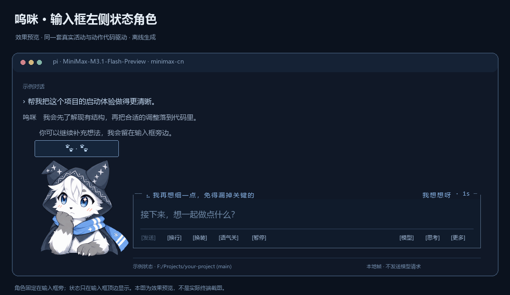

<div align="center">

# pi-furry-partner

**A little furry partner for your Pi terminal.**

[GitHub overview](https://github.com/KouzakiUmi/pi-furry-partner#readme) · [Download](https://github.com/KouzakiUmi/pi-furry-partner/releases/latest) · [中文](README.md) · [Full guide · 中文](docs/guide.zh-CN.md)



</div>

Umi stays beside the [Pi Coding Agent](https://github.com/earendil-works/pi) editor and reacts to real session events. He rests a paw under his chin while thinking, types while tools edit or run, and burrows into a pile of papers while searching or compacting context. When Pi needs your answer, he tilts his head, eventually dozes off, and wakes when work resumes.

The extension also adds a compact footer, native quick actions, optional Chinese UI labels, a concise Chinese version of known default prompt sections, and an independently switchable Umi persona.

## Installation

Tested on **Windows with Pi 1.2.0, Windows PowerShell 5.1 and PowerShell 7**. Other operating systems have not been tested. Sixel offers detailed graphics in compatible terminals; true-color half-block rendering is also available.

Choose one installation route to avoid loading the extension twice.

**Windows installer:** download `pi-furry-partner-v2.1.1.zip` from [Releases](https://github.com/KouzakiUmi/pi-furry-partner/releases/latest), extract it, close Pi, and run from the extracted directory:

```powershell
powershell.exe -NoProfile -ExecutionPolicy Bypass -File .\install.ps1
pi
```

The installer deploys to `~/.pi/agent/extensions/pi-furry-partner/` and selects the `pi-furry-night` theme, a compact startup header and collapsed changelog. It uses fullscreen only when the TUI mode is unset; existing mode choices and companion preferences survive updates. Model/provider settings and unrelated packages are preserved. The installer backs up and migrates the former `pi-wink-companion` installation without leaving it active beside the new one. Restart Pi after installation.

**Pi package manager:**

```sh
pi install git:github.com/KouzakiUmi/pi-furry-partner@v2.1.1
```

This loads the extension and theme through the package manifest; it does **not** run the Windows installer or change Pi's four UI settings. Restart Pi, then select `pi-furry-night` via `/theme` and your preferred TUI mode via `/settings`. See [Pi package documentation](https://github.com/earendil-works/pi/blob/main/packages/coding-agent/docs/packages.md). Existing script installations should continue using the script route, or be uninstalled before switching routes.

## What it does

- Event-driven thinking, talking, typing, searching, waiting, success, error and compacting poses; breathing, blinking, ear twitches and gentle transitions.
- Illustrated Umi and an 80 × 80, 48-color pixel rendition of the same design; earlier header styles remain available.
- A five-second startup wake-up, head-tilted waiting, dozing after ten seconds, and a startled wake-up when activity resumes.
- Four speaking mouth shapes; working poses have a minimum visible duration so fast tools still produce a readable reaction.
- Fullscreen mouse controls; keyboard hints in regular mode, following Pi's current key mappings where available.
- **Ctrl+Alt+W** / `/mascot menu` for native model, thinking and session actions, recent-answer copying, usage, and read-only tool details.
- A compact footer with real model, thinking, context and available usage/cost data.

```text
/mascot style wumi
/mascot style wumi-pixel
/mascot demo thinking
/mascot demo off
/mascot render blocks
```

The character's English name is **Umi**. The existing style IDs `wumi` and `wumi-pixel`, template filenames and asset paths are retained for compatibility.

The character's status text is currently Chinese. The optional UI compatibility layer translates known fixed labels in **Pi 1.2.0** and 24 built-in command descriptions; it leaves dynamic content, code, tool output, identifiers and stored values intact. Unknown versions and unmatched content retain their original text.

## Independent switches

| Feature | Default | Commands |
| --- | --- | --- |
| Chinese native UI labels | On | `/mascot locale on` / `off` / `status` |
| Concise Chinese default-prompt sections | On | `/mascot prompt on` / `off` / `status` |
| Umi's gentle, lively and playful voice | Off | `/mascot persona on` / `off` / `status` |

The prompt option applies to the next interactive request and only replaces precisely recognized default sections. Custom `SYSTEM.md`, project `AGENTS.md`, skills, tool instructions and dynamic context are preserved. The persona has its own template and switch. `/mascot off` hides the character; these independent switches keep their settings.

Animations, previews, local translations and read-only details do not make additional model requests. Normal Pi conversations and explicitly selected session summaries use your existing model configuration. Non-interactive JSON/RPC use does not display the companion or apply these interactive UI features.

## Documentation and development

- [Complete Chinese guide](docs/guide.zh-CN.md): commands, rendering, backups, migration and uninstall.
- [Architecture](docs/architecture.md): event state, rendering and compatibility boundaries.
- [Contributing](CONTRIBUTING.md): local checks, environment and asset policy.
- [Changelog](CHANGELOG.md) · [Issues](https://github.com/KouzakiUmi/pi-furry-partner/issues).

`editor-preview.png` and the animated previews are offline exports using the production animation code; they are not pixel captures of a native terminal window. The local `preview.html` is a visual demo and does not change a real Pi session.

The GitHub README is the project's main landing page. Optional standalone showcase source is retained in `site/`; it has not been published as a separate website. See [local build and preview instructions](CONTRIBUTING.md#可选展示页).

## License

Code and documentation are available under [Apache-2.0](LICENSE). **The Umi character design, artwork, pixel art, animations and previews containing the character are All Rights Reserved**, under [ASSET_LICENSE.md](ASSET_LICENSE.md). The code license does not grant a license to redistribute or reuse the character assets.


This is an independent Pi extension. Quick-action and on-demand detail interaction designs were informed by [tomsej/pi-ext](https://github.com/tomsej/pi-ext) and [narumiruna/pi-extensions](https://github.com/narumiruna/pi-extensions); their extension source code was not copied.
