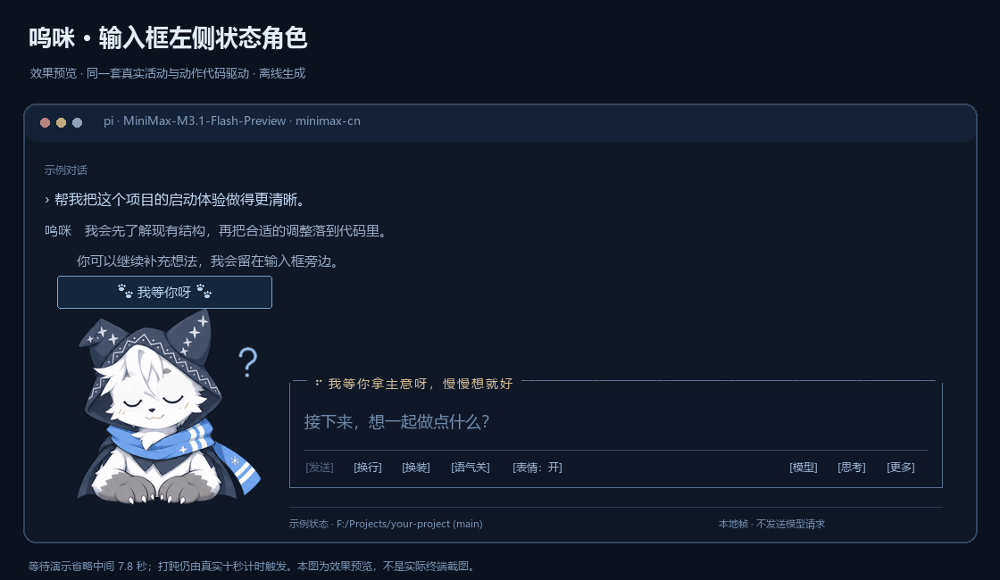
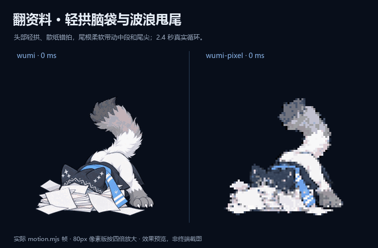
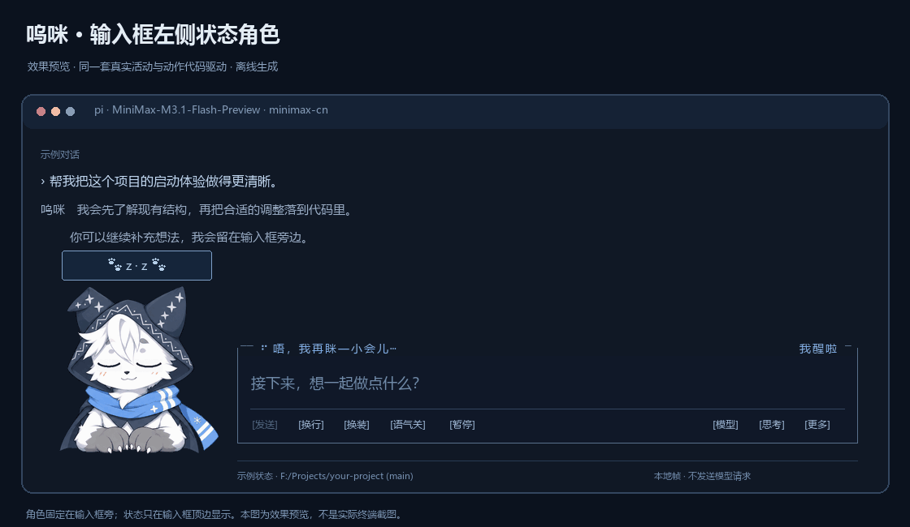
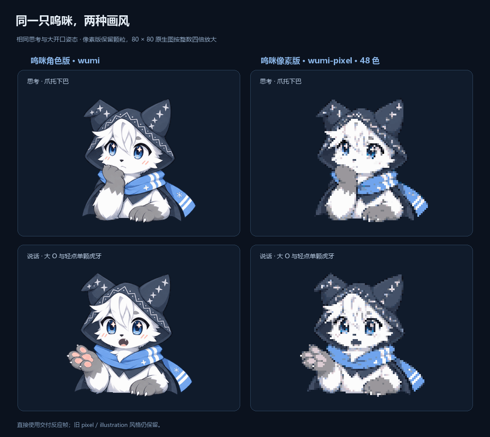

<div align="center">

**简体中文** | [**English**](README.en.md)

# pi-furry-partner

**把终端里的等待，交给一只会认真陪你工作的毛茸茸。**

呜咪 · Umi — a little furry partner for your Pi terminal.

<sub>会思考 · 会敲键盘 · 会摇尾巴 · 也会等你回来</sub>

[](https://github.com/KouzakiUmi/pi-furry-partner/releases/tag/v2.3.1)
[](https://github.com/earendil-works/pi)
[](LICENSE)
[](ASSET_LICENSE.md)

[**下载 v2.3.1**](https://github.com/KouzakiUmi/pi-furry-partner/releases/tag/v2.3.1) · [**快速安装**](#安装) · [完整指南](docs/guide.zh-CN.md)

[动画与风格](#先看看呜咪) · [快捷操作](#开始相处) · [中英切换](#用你习惯的语言) · [独立开关](#三个独立开关)


<sub>图中为生产动画代码导出的离线效果预览，示例内容用于展示布局。</sub>

</div>

> 🐾 「我在这儿，把想法慢慢说给我听吧。」

呜咪会待在 [Pi Coding Agent](https://github.com/earendil-works/pi) 输入框左边：想事情时托着下巴，修改文件时敲敲键盘，运行命令时举着放大镜左右看看，找资料时一头钻进纸堆，只留尾巴在外面晃。你需要拿主意时，他会歪头等你；等得久了就悄悄打个盹，回来又被你叫醒。

外观之外，插件也整理了输入框、底部信息和常用操作。角色短句、控件和信息面板默认跟随系统，也可以切换**简体中文或 English**；**原生界面中文、Pi 文档提示精简、可选角色口吻**则各有开关。你可以继续使用熟悉的模型和工作方式。

## 认识呜咪

<table>
<tr>
<td align="center" width="360">
<br>
<sub>角色实拍 · Umi in costume</sub>
</td>
<td valign="middle">
<h3>呜咪 · Umi</h3>
<p>一只白灰毛、蓝眼睛的 Kemono 狼少年。灰爪子、星纹兜帽和蓝围巾，让你一眼就认出他。</p>
<p>温柔、活泼，带一点俏皮；平时会歪头听你说，也会忍不住晃晃尾巴。到了需要认真拿主意的时候，他会收起玩心，稳稳陪你把事情做好。</p>
<p>🐾「唔，把想法告诉我吧。咱们一起慢慢做出来！」</p>
<sub>呜咪的角色实拍。角色与照片保留全部版权，详见 <a href="ASSET_LICENSE.md">素材版权说明</a>。</sub>
</td>
</tr>
</table>

## 先看看呜咪

<table>
<tr>
<td align="center" width="50%">
<strong>等你拿主意</strong><br>
<sub>歪头听你说，等久了就打个小盹</sub><br><br>

</td>
<td align="center" width="50%">
<strong>我钻进去找找</strong><br>
<sub>资料堆里的小脑袋，和藏不住的尾巴</sub><br><br>

</td>
</tr>
</table>

<div align="center"><sub>离线动画预览 · 左侧省略了部分空等时间 · 右侧并排展示插画与像素风</sub></div>

| 正在想办法 | 正在动手 | 等你回来 | 事情收尾 |
| --- | --- | --- | --- |
| 灰爪托下巴、眨眼、气泡里的 `· · ·` | 修改时双爪打字，运行时举着放大镜平顺左右扫描、到边上稍停；短调用也能看清 | 歪头问号，10 秒后打盹，再工作时惊醒 | 成功挥爪 wink；出错时 xx 眼吃瘪 |

搜索和整理会共用“埋进资料堆”的连续动作：脑袋轻轻拱动，尾巴灵活地甩甩，纸页跟着轻晃，身体和斗篷一起自然衔接。说话有 `w / — / o / O` 四种嘴型，实际没有新文本时会自然闭嘴。呼吸、耳抖和短过渡让其他姿态也更有生气。

<details>
<summary><strong>展开看完整动画与两种呜咪风格</strong></summary>






这些都是离线导出图。本地 `preview.html` 可以切换状态与界面示意，不会发送模型请求；另外保留了一份可选的独立展示页源码，开发预览方式见[贡献指南](CONTRIBUTING.md#可选展示页)。

</details>

## 安装

需要先安装并配置 Pi。本项目的完整验证环境是 **Windows、Pi 1.2.0、Windows PowerShell 5.1 / PowerShell 7**，另在 Pi 1.3 验证了输入、拖选、鼠标和图像传输等交互。原生中文界面与 Pi 文档提示精简目前仅支持 1.2.0，其他版本保留 Pi 原有行为。其他平台暂未完成实机验证。图片使用 Sixel 或真彩色半块字符；终端支持会影响清晰度。

两种安装方式选一种，避免把同一插件加载两次。

### Windows 完整安装

从 [Releases](https://github.com/KouzakiUmi/pi-furry-partner/releases/tag/v2.3.1) 下载 `pi-furry-partner-v2.3.1.zip` 并解压，关闭 Pi，在解压目录打开 PowerShell：

```powershell
powershell.exe -NoProfile -ExecutionPolicy Bypass -File .\install.ps1
pi
```

脚本把扩展安装到 `~/.pi/agent/extensions/pi-furry-partner/`，并安装 `pi-furry-night` 主题。安装会设置配套主题、简短启动标题和折叠更新日志；界面模式尚未设置时使用 `fullscreen`，已有模式和更新时的角色偏好保留。模型、provider、工具配置和其他包继续沿用原设置。执行策略参数只作用于本次进程。

旧名 **pi-wink-companion** 的用户可直接运行新版安装脚本：它会备份并迁移旧安装，保留配置，归档旧目录以避免重复加载。安装后完整退出并重新启动 Pi。详细的备份、迁移与恢复规则见[安装指南](docs/guide.zh-CN.md#安装与启动)。

### 使用 Pi 包管理器

```sh
pi install git:github.com/KouzakiUmi/pi-furry-partner@v2.3.1
```

这条命令通过包清单加载扩展和主题，**不会执行 PowerShell 安装脚本，也不会替你设置 Pi 的四个 UI 选项**。重启 Pi 后可在 `/theme` 选择 `pi-furry-night`，在 `/settings` 选择界面模式。Git tag 用于固定版本；后续更新可选择新的发布 tag。[Pi 官方包文档](https://github.com/earendil-works/pi/blob/main/packages/coding-agent/docs/packages.md)说明了包来源与版本管理。

已有脚本安装的用户，继续使用脚本路线更新；需要改用包管理器时，先按指南卸载脚本安装，避免双份扩展。

## 开始相处

```text
/mascot style umi           插画风呜咪
/mascot style umi-pixel     同一造型的像素风
/mascot menu                打开常用操作
/mascot poke                轻轻戳一下呜咪
/mascot language en         切换为英文
/mascot language zh-CN      切回简体中文
/mascot demo                循环看看全部动作，不调用模型
/mascot demo off            回到真实会话
```

`/mascot` 查看当前设置。更多尺寸、布局、渲染和演示命令见[完整命令表](docs/guide.zh-CN.md#命令)。

`/mascot demo` 或 `/mascot demo all` 会自动循环一轮一分多钟的动作展示：聆听、思考、说话、工作和戳戳都会出现；放大镜和搜索能完整看一圈，等待阶段也会打盹、再惊醒。演示不请求模型、不改配置和输入草稿，`demo off` 或开始真实任务都会退出。只看某个动作时，仍可使用 `/mascot demo thinking` 或 `/mascot demo running`。

角色英文名和风格命令统一使用 **Umi / `umi`**。旧命令 `wumi`、`wumi-pixel` 仍可作为兼容别名，新保存的风格使用 `umi`、`umi-pixel`。

`umi-pixel` 保留角色版的造型、五官和动作，以 **80 × 80** 显示。嘴线等细节采用局部保线处理，减少细笔画在缩小采样中丢失；线条颜色轻微整理，不重新设计角色。

**输入区会适应 Pi 的当前模式。** `fullscreen` 底边显示可点击控件，右侧可选模型、切换思考等级、打开更多操作；`regular` 自动改成快捷键提示。在 `/settings` 切换模式后会即时跟随。两种模式都能按 **Ctrl+Alt+W** 或输入 `/mascot menu`，查看用量、浏览可用工具、复制最近回答、进入会话或对话树等。

**2.3.1 修复拖选后头像出现黑条、输出停住的问题。** 图像标记去重与隐藏光标标记解析分别处理：前者避免条带错列，后者防止选区复制的 Pi 私有标记阻塞后续刷新。拖选、草稿、光标与发送仍由 Pi 原生处理；验证覆盖真实 Pi 的选区与输出协议，不等同于所有 Windows Terminal 环境的实机验收。

紧凑 footer 显示模型与 provider、思考等级、上下文和实际提供的 token / 缓存 / 费用数据。窄窗口优先保留编辑空间，空间不足时收起大头像。输入、补全和发送继续沿用 Pi 原生编辑器。

想逗逗呜咪，可以在 `fullscreen` 点击头像，或在任意模式输入 `/mascot poke`。他会短暂露出 `>w<` 表情、缩缩身子再轻轻晃一下，用当前语言随机回你一句。忙着工作时轻轻一晃，回一句还在认真干活的小回应；空闲时就放松一点闹一小下，然后接着做手头的事。

输入框里的 **`表情：开` / `表情：关`** 显示当前状态。关闭后停止循环微动，静态姿态仍跟随 agent 状态更新；主动戳戳仍会播放短暂回应。也可以用 `/mascot pause` / `/mascot play` 切换。

提交消息后，输入框顶边会显示“准备请求”“等首个输出”或“收到思考、等正文”，并带上已等待的秒数。进入等首输出后，10 秒仍没有回音会明确提示模型还没开口，15 秒起使用提醒色。关闭循环表情时，等待提示仍每秒更新。

表情开启时，空闲或等你回答的真实输入内容变化会让呜咪把灰爪放到耳边，轻轻侧身点头听你说；停下约 1.8 秒后回到原状态。工作中的工具动作继续保留，戳戳回应优先。

## 用你习惯的语言

```text
/mascot language auto       跟随系统语言（默认）
/mascot language zh-CN      简体中文
/mascot language en         English
/mascot language status     查看当前语言
```

语言偏好会保存到 `config.json`，默认是 `auto`：检测系统语言，中文环境显示简体中文，其他语言环境使用 English。已有配置未设置语言时也使用自动检测；已经明确选择的 `en` 或 `zh-CN` 会继续保留。执行 `/mascot language auto` 可随时恢复跟随系统，`status` 会显示偏好与实际使用的语言。切换后，角色状态短句、气泡、输入框控件、快捷菜单和信息面板立即更新，当前任务、输入草稿与动作节奏继续保留。角色的默认显示名会随语言显示为“呜咪”或 **Umi**，你自定义的名字和副标题保持原样。

英文模式沿用 Pi 原生英文界面；`locale` 的中文补丁偏好会保留，切回中文时再按原设置应用。`prompt` 开启时，仅把已确认的 Pi 文档提示章节精简为对应语言，关闭时恢复这段文档提示原文；身份说明、工具和规则始终沿用 Pi 原生内容；`persona` 独立控制角色口吻，也随实际语言选择模板。提示词与口吻的变化从下一轮请求生效。代码、工具输出、模型名、路径和项目指令不会因为切换语言被翻译。

## 三个独立开关

| 功能 | 默认 | 开启 / 关闭 |
| --- | --- | --- |
| 原生界面中文偏好 | 开启；中文模式应用 | `/mascot locale on` / `off` |
| Pi 文档提示精简 | 开启；随语言使用中文或英文 | `/mascot prompt on` / `off` |
| 呜咪角色口吻 | 关闭 | `/mascot persona on` / `off` |

三者都支持 `status`。`/mascot off` 关闭界面角色；这些开关各自保留，需要分别关闭。

- **界面中文**：中文模式下，兼容 Pi **1.2.0** 的已知固定界面文字，以及 24 个内置命令补全说明。设置主列表可搜索中文标签。英文模式保留原生英文，其他版本或未知内容保留原文。
- **Pi 文档提示精简**：下一轮请求中，仅将精确识别的 Pi 文档提示章节改成简洁中文或英文，保留文档路径、完整阅读和交叉引用要求。身份说明、工具清单与规则保持原生；自定义 `SYSTEM.md`、项目 `AGENTS.md`、技能和后续扩展加入的动态内容继续沿用。关闭后不替换该文档章节。表达更短不代表所有模型的 token 都按相同比例减少。
- **角色口吻**：温柔、可爱、活泼，带一点俏皮；关键事情认真稳重。中英文各有独立模板，随当前语言选用；只调整表达，技术准确性、代码和结构化输出优先。

界面与动画、中文处理、只读信息面板和演示都在本地完成，不额外调用模型 API。正常 Pi 对话及你主动选择的会话摘要继续使用已有模型配置。JSON、RPC 等非交互模式不会显示角色或应用这些交互界面功能。

## 文档与开发

| 想做什么 | 从这里开始 |
| --- | --- |
| 安装、配置、语言、切换风格、卸载与恢复 | [完整中文指南](docs/guide.zh-CN.md) · [English guide](docs/guide.en.md) |
| 了解状态、渲染与中文兼容层 | [架构说明](docs/architecture.md) |
| 修改文案、增加功能、运行测试 | [贡献指南](CONTRIBUTING.md) |
| 查看这次发布的变化 | [更新记录](CHANGELOG.md) |
| 报告问题或提出建议 | [GitHub Issues](https://github.com/KouzakiUmi/pi-furry-partner/issues) |

测试覆盖状态节奏、输入区布局、鼠标路由、Sixel 数据流、中文兼容和提示词边界，并在隔离目录验证安装、迁移与恢复。Pi 1.2.0 的完整测试已通过；Pi 1.3 另做了交互回归，未据此扩大原生中文或提示词兼容范围。环境准备和执行方式见贡献指南，验证范围与终端限制见[使用指南](docs/guide.zh-CN.md#素材与验证范围)。

## 许可与致谢

代码与文档采用 [Apache License 2.0](LICENSE)。**呜咪的角色设计、形象、照片、插画、像素图、动画和包含角色的预览图保留全部权利**，不随代码许可开放；详见 [ASSET_LICENSE.md](ASSET_LICENSE.md)。


本项目是独立制作的 Pi 扩展。感谢 [Pi](https://github.com/earendil-works/pi) 提供扩展与终端界面能力；快捷入口和按需详情的交互设计参考了 [tomsej/pi-ext](https://github.com/tomsej/pi-ext) 与 [narumiruna/pi-extensions](https://github.com/narumiruna/pi-extensions)，未复制其扩展源码。
