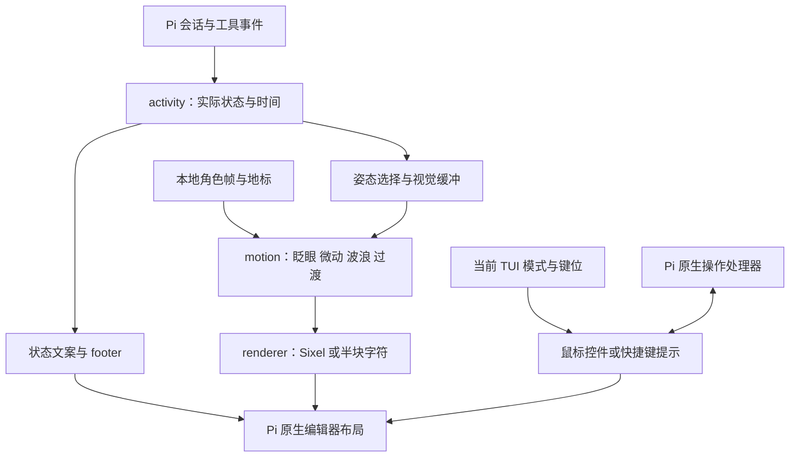

# 架构说明

[中文首页](../README.md) · [English overview](../README.en.md) · [使用指南](guide.zh-CN.md) · [English guide](guide.en.md) · [贡献指南](../CONTRIBUTING.md)

`pi-furry-partner` 是 Pi Coding Agent 扩展。核心思路是把**实际任务状态**与**角色可读的视觉节奏**分开：状态信息及时更新，角色的短动作有足够的可见时间，输入和工具执行不等待动画结束。

## 数据如何流动

这是逻辑关系图；动画更新仍进入 Pi 的渲染流程，不建立绕过终端布局的第二套绘制循环。

## 主要模块

| 入口或目录 | 职责 |
| --- | --- |
| `index.ts` | 注册会话事件、`/mascot`、快捷键、原生编辑器与生命周期；读取独立设置 |
| `lib/response-latency.mjs` | 本地请求准备、首输出与首正文等待计时；不推测服务端原因 |
| `lib/listen.mjs` | 将输入倾听附加姿态映射到原有调色板 |
| `lib/activity.mjs` | 由会话、消息、工具与提问事件得到状态、工具信息和时间 |
| `lib/language.mjs` | 解析 `auto` 系统语言或中英文偏好，选择本地文案并组织插件界面文本 |
| `lib/styles.mjs` | 归一化 `umi` 风格及旧别名，映射到稳定的内部素材目录 |
| `lib/editor-layout.mjs` | 侧边角色、气泡与输入框几何；按终端空间收起头像 |
| `lib/motion.mjs` | 对不可变的索引像素帧做视觉变换；耳、爪、尾巴、纸页与过渡 |
| `lib/renderer.mjs` / `lib/sixel.mjs` | 图像采样、Sixel 编码与终端传输；半块字符回退 |
| `lib/editor-controls.mjs` | 全屏命中区域、常规模式键位提示与窄宽度取舍 |
| `lib/quick-actions.mjs` | 将菜单选择映射到 Pi 原生操作，以及只读用量与工具详情 |
| `lib/footer.mjs` | 根据实际提供的数据组织紧凑信息，未知值保持未知 |
| `lib/overlay-visibility.mjs` | 追踪原生弹窗交叠，遮挡相交图像条带，处理共享挂钩与释放 |
| `lib/ui-chinese.mjs` | 严格版本与结构校验后的原生界面中文视图兼容层 |
| `lib/command-chinese.mjs` | 精确匹配内置命令和说明，只翻译补全说明 |
| `lib/native-prompt.mjs` | 运行时只精简已确认的 Pi 文档提示章节，保留原生身份、工具与规则；另提供离线格式化函数 |
| `assets/` | 本地状态文案、颜色索引帧、角色原稿与动画地标 |
| `prompts/` | 独立的中英文呜咪口吻模板，以及离线格式化工具的中英文前言 |
| `themes/pi-furry-night.json` | 配套 Pi 主题 |
| `site/` | 保留的可选静态展示页源码；尚未作为独立网站发布，运行插件不依赖它 |

## 实际状态与视觉节奏

状态包括 `idle`、`waking`、`thinking`、`speaking`、`reading`、`editing`、`running`、`searching`、`waiting`、`success`、`error`、`cancelled` 和 `compacting`。等待用户答复和等待系统回音共用等待姿态，但使用不同文案。

`activity` 记录工具开始与结束，而不只在绘制时观察“是否仍在运行”。因此工具在两次绘制之间完成，也能留下可读的打字反应。修改与运行姿态至少约 1.2 秒，包含短过渡；回到思考时再有约 240ms 缓冲。真实顶边状态不受这段视觉保留影响。

文本输出事件触发嘴型循环，文本结束或一段时间没有新文本后闭嘴。思考不会被显示成持续说话。启动睡醒、等待打盹与惊醒也只改变角色表现，不延迟工具或请求。

## 输入、鼠标与输出

输入区使用 Pi 的自定义编辑器能力，保留原生文本编辑、补全、IME、键位与发送流程。每次渲染读取当前 TUI 模式：

- `fullscreen`：由 Pi 的鼠标路由处理按钮与头像点击，原生动作处理器在实际点击时获取。
- `regular`：绘制键盘提示，不登记伪按钮命中区域；鼠标继续由终端处理。

模式切换时保留编辑器对象与草稿。布局与图像条带的更新配合 Pi 的输出刷新；弹窗与角色相交时只避让实际交叠部分。插件不全局过滤 `terminal.write`，也不把工具正文当作 UI 文案处理。

Sixel 需要终端支持。`auto` 在 Windows Terminal 环境优先选择 Sixel，在其他环境选择半块字符；用户可以强制切换。终端、字体、DPI 和窗口大小仍会影响最终显示，协议与布局检查不能替代每一种终端环境的实机验收。

## 三个互不合并的文本功能

`language` 保存插件的语言偏好，支持 `auto`、`zh-CN` 与 `en`；缺失时默认 `auto`。自动模式检测系统语言，中文环境解析为 `zh-CN`，其他语言环境解析为 `en`；显式语言选择优先。它选择本地状态文案和界面文本，不改变活动状态、输入草稿或用户动态内容。三个功能偏好仍分别保存，切换语言不会覆盖它们。

| 设置 | 作用时间 | 处理范围 |
| --- | --- | --- |
| `chineseUI` | 后续界面绘制或菜单打开 | 已知固定标签、说明与补全描述 |
| `compactPrompt` | 下一轮交互请求 | 仅精确识别的 Pi 原生文档提示 `docs` 章节 |
| `persona` | 下一轮交互请求 | 按当前语言追加独立的中文或英文呜咪口吻模板 |

中文视图兼容层只在实际显示语言为 `zh-CN` 且 `chineseUI` 开启时应用；英文模式保留这个偏好但暂停补丁。它检查 Pi **1.2.0** 和目标组件形状，临时提供翻译后的显示信息，由原生布局计算中文宽度，随后恢复原数据。原始 ID、值、回调与用户动态内容保持原样。共享挂钩在释放时核对所有权，避免覆盖后来安装的第三方处理器。

运行时在 `compactPrompt` 开启时识别已知默认结构，仅通过 Pi 的结构化 `sections.docs` 精简文档提示，按实际语言使用中文或英文；关闭时不覆盖该章节。身份前言、工具清单和规则保持原生构建，后续扩展动态新增的工具、片段、指南和其它章节仍然有效。项目 `AGENTS.md`、技能、动态路径、自定义 `SYSTEM.md`、强制提示词、自定义文档章节及未知版本或结构保持原文。角色口吻根据自己的开关和当前语言加入独立的 `umi_persona` 章节。这两个功能都不强制返回整串渲染后的系统提示词。仓库仍保留完整提示词格式化纯函数与中英文前言，供离线开发使用。

上述功能只作用于 Pi 交互终端路径；非交互模式不启动角色动画或安装这些 UI 挂钩。

## 安装与数据范围

Windows 安装器使用阶段目录部署，并在替换前备份旧扩展、主题、设置和安装记录。新名称迁移会归档旧自动发现目录，保留已有 2.x 配置与恢复基线，旧风格 ID 仅进行精准别名迁移。卸载按当前值与安装值逐字段决定是否恢复，保留用户后来改动的设置。详情见[恢复规则](guide.zh-CN.md#备份卸载与恢复)。

原生 `pi install` 路线由 Pi 的包管理器负责获取与加载清单资源，不调用这些安装脚本。两条安装路线应择一使用。

本地角色和只读面板无需额外网络请求；插件不上传角色状态。正常模型对话、原生导航中主动选择的摘要操作等仍由 Pi 的既有模型流程负责。

## 验证层次

测试用固定时钟检验动作持续时间，用真实 Pi 模块检验编辑器、组件与补全，用隔离 `AgentDir` 检验安装恢复。离线预览共用生产状态与动画代码。实际 Pi / Windows ConPTY 检查验证进程及传输；原生窗口像素与所有终端组合仍需要对应环境复现。

运行方式与贡献要求见 [CONTRIBUTING.md](../CONTRIBUTING.md)。
