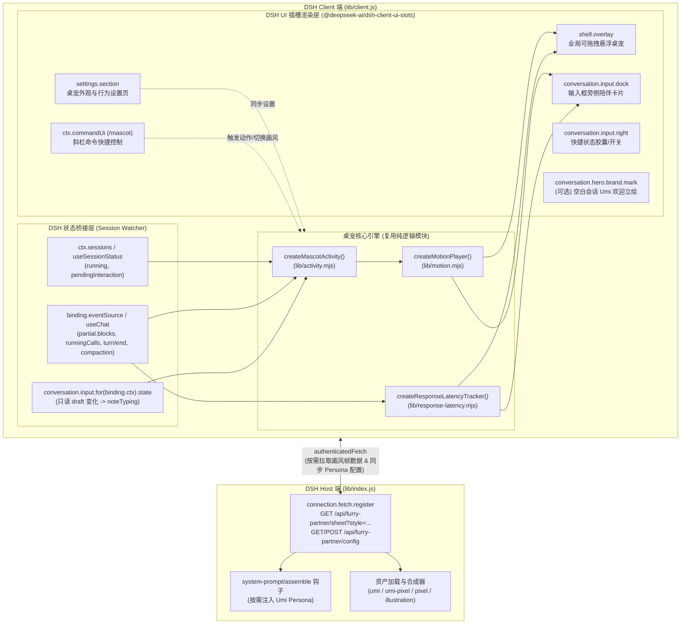

> 历史方案说明：当前 DSH 仅保留独立浮动桌宠、独立标题图和设置入口；输入框胶囊及停靠方案不注册，也不保留占位。标题使用独立挥爪动图／静态 PNG，不跟随桌宠状态。现行实现见 [DSH 标题与浮动桌宠](dsh-branding.md)。

# `pi-furry-partner` 适配 DSH（DeepSeek Harness）桌宠插件设计文档

## 1. 背景与适配目标

[`pi-furry-partner`](../package.json) 原本是为 **Pi Coding Agent** 终端（TUI）打造的橘白犬兽人（Umi / 呜咪）陪伴扩展，采用「Sixel 终端图像协议 + 半块字符（Half-block ANSI）回退」在命令行输入框左侧渲染动画，并通过拦截 Pi 的 Agent 生命周期事件驱动情绪、动作、气泡短语和响应耗时计时。

**DSH（DeepSeek Harness）** 采用 **Cordis 微内核 + Host（Node.js 服务端）/ Client（React + Zustand Web/Electron 客户端）** 双端插件架构。将本项目适配为 DSH 桌宠插件（`dsh-furry-partner`）的核心目标是：

1. **百分百复用原项目的灵魂内核**：完整保留 [`lib/activity.mjs`](../lib/activity.mjs)（状态机与情绪/气泡编排）、[`lib/motion.mjs`](../lib/motion.mjs)（161 帧骨骼/像素微动与过渡播放器）、4 套画风资产（`umi` / `umi-pixel` / `pixel` / `illustration`）、打字倾听（`listening`）、戳一戳（`poke`）、70.9 秒 `DEMO_SEQUENCE` 巡演、等待耗时阶梯反馈（[`lib/response-latency.mjs`](../lib/response-latency.mjs)）及可选的 Umi 角色口吻（[`prompts/umi-persona.md`](../prompts/umi-persona.md)）。
2. **用 Web HTML5 `<canvas>` 取代终端字符/Sixel 渲染**：利用浏览器原生 Canvas 实现真彩色、自适应帧率、无闪烁的高清立绘（`240×240`）与像素画（`80×80` `image-rendering: pixelated`）渲染，彻底摆脱终端字体宽高比与 Sixel 兼容性限制。
3. **提供符合 GUI 直觉的「双形态桌宠」体验**：
   - **形态 A：全局悬浮桌宠模式（Floating Desktop Pet）** —— 挂载于 DSH 根级浮层插槽 `shell.overlay`，支持自由拖拽、贴边吸附、气泡方向自适应、最小化为爪印徽章，跨会话与设置页常驻陪伴。
   - **形态 B：输入框陪伴模式（Composer Companion）** —— 挂载于会话输入区插槽 `conversation.input.dock` / `conversation.input.right`，复刻原版 Pi 在输入框旁侧陪伴 + 顶部响应计时条的紧凑体验。

---

## 2. 原项目模块去留与映射矩阵

原项目将**状态与动画逻辑**（`lib/*.mjs` 纯函数模块）与**终端宿主层**（[`index.ts`](../index.ts)）做了解耦，这为迁移到 DSH 提供了极佳的基础：

| 原项目模块 / 资产 | 职责说明 | DSH 适配策略 | 在 DSH 中的对应落点 |
| :--- | :--- | :--- | :--- |
| [`lib/activity.mjs`](../lib/activity.mjs) | 14 种主状态 + 4 种反应态、工作态 1200ms 视觉保持、嘴巴开合、70.9s Demo 序列 | **直接复用** | Client 端状态机核心 |
| [`lib/motion.mjs`](../lib/motion.mjs) | 帧序列插值、多边形区域（耳/爪/尾）微动变形、烘焙动作（`watch` 65 帧 / `search` 72 帧） | **直接复用** | Client 端 `<canvas>` 渲染管线 |
| [`lib/poke.mjs`](../lib/poke.mjs) / [`listen.mjs`](../lib/listen.mjs) / [`watch.mjs`](../lib/watch.mjs) / [`search.mjs`](../lib/search.mjs) | 将基础 21 帧立绘补丁合成为完整 161 帧 `sheet` | **直接复用** | Host 端预构建或按需合成帧表 |
| [`lib/response-latency.mjs`](../lib/response-latency.mjs) | `receipt` / `preparing` / `first-output` / `first-text` 四阶段耗时统计与 10s/15s 变色阈值 | **直接复用** | Client 端耗时徽章与状态副标题 |
| [`lib/styles.mjs`](../lib/styles.mjs) & [`lib/language.mjs`](../lib/language.mjs) | 4 种画风归一化、中英双语自动检测与文案解析 | **直接复用** | Client & Host 共享配置工具 |
| [`assets/status-copy*.json`](../assets/status-copy.json) & [`status-phrases*.json`](../assets/status-phrases.json) | 中英文状态标签、气泡文案、戳一戳短语池 | **直接复用** | 内联至 Client 端（体积仅 ~20KB） |
| [`prompts/umi-persona*.md`](../prompts/umi-persona.md) | 可选的 Umi 角色语气 System Prompt 注入 | **适配迁移** | Host 端拦截 `system-prompt/assemble` 事件注入 |
| [`site/app.js`](../site/app.js) 中的 `drawSheetFrame` | 浏览器端将调色板索引帧绘制到 `ImageData` / Offscreen `<canvas>` 并缓存位图 | **提炼升级** | Client 端 `CanvasMascotRenderer` 组件 |
| [`lib/sixel.mjs`](../lib/sixel.mjs) / [`lib/renderer.mjs`](../lib/renderer.mjs) / [`lib/overlay-visibility.mjs`](../lib/overlay-visibility.mjs) | 终端 Sixel 编码、ANSI 半块字符渲染、TUI 弹窗遮挡裁剪 | **废弃移除** | 由 Web Canvas + DOM 层级（`z-index`）自然替代 |
| [`lib/ui-chinese.mjs`](../lib/ui-chinese.mjs) / [`lib/command-chinese.mjs`](../lib/command-chinese.mjs) / [`lib/native-prompt.mjs`](../lib/native-prompt.mjs) | Pi TUI 界面汉化 Monkey-patch 与 Pi 内置文档精简 | **废弃移除** | DSH 已有专门的 `dsh-prompt-zh` 插件处理汉化，桌宠插件保持职责单一 |

---

## 3. 整体系统架构

遵循 DSH 插件规范（`manifestVersion: 1`），插件分为 **Host 端（Node.js）** 与 **Client 端（Web/Electron 渲染进程）** 两部分，通过 DSH 的 `connection.fetch`（认证 HTTP 接口）进行大体量帧资产按需加载与配置同步，通过 Client 端的 `sessions` / `chat` / `input` 服务实时订阅 Agent 状态。



---

## 4. 核心实现逻辑详解

### 4.1 帧资产按需加载与 Canvas 渲染管线（解决 13.8MB 体积问题）

在原项目构建产物中，`umi`（240×240，161 帧）与 `umi-pixel`（80×80，161 帧）展开后的 JSON（`dist/assets/animation-sheets.json`）高达 **13.78 MB**（其中 `umi` 占 12.39 MB，`umi-pixel` 占 1.40 MB），而原始基础素材 + 4 个补丁文件（`reaction-sheet.json` + `poke-patch.json` + `watch-frames.json` + `listen-frames.json` + `search-frames.json`）在磁盘上共约 **3.4 MB**。**绝对不能**将 13.8 MB 的数据直接打包进 `lib/client.js`，否则会严重拖慢 DSH 客户端启动与脚本解析。

**设计方案：Host 端接口按需分发 + Client 端多级位图缓存**

1. **轻量级内联回退（0 延迟首屏）**：
   - `pixel`（32×32）和 `illustration`（48×48）两套轻量级生成式帧表体积很小，或提取 `umi` 的第 0 帧（`calm` 静态帧）内联在 `client.js` 中，确保插件挂载瞬间即可零等待绘制出 Umi 形象。
2. **Host 端按风格懒加载路由（`/api/furry-partner/sheet`）**：
   - 在 `lib/index.js` 中通过 `connection.fetch.register({ path: '/api/furry-partner/sheet', ... })` 注册接口。
   - 当客户端请求 `?style=umi` 或 `?style=umi-pixel` 时，Host 读取 `assets/umi/` 或 `assets/umi-pixel/` 下的原始 JSON 合成完整 Sheet 返回给 Client，并在客户端内存中按 `style` 缓存（切换过一次画风后无需二次请求）。
3. **Canvas 渲染与位图缓存（复用并增强 `site/app.js` 渲染器）**：
   - 每帧数据由调色板 `palette: [[r,g,b,a], ...]` 和 Base64 编码的索引数组 `pixels` 组成。
   - **首次解码**：当 `motion.sample(now)` 采样到某个帧（带有 `frameIndex`、多边形微动偏移或 `bakedMotion` 帧）时，先将 Base64 解码为 `Uint8Array` 并缓存到 `frame.__decoded`（避免每帧重复 `atob`）。
   - **离屏 Canvas 缓存（LRU 64 帧）**：通过 `quantizeMotionSample` 生成离散缓存 Key，将解码后的像素写入离屏 `<canvas>`，缓存在 `Map`（上限 64 个活跃姿态位图）中。
   - **主画布绘制**：主 `<canvas>` 直接调用 `ctx.drawImage(cachedCanvas, ...)`。对于 `umi-pixel` / `pixel` 风格，设置 `ctx.imageSmoothingEnabled = false`（呈现锐利像素颗粒感）；对于 `umi` / `illustration` 风格，开启 `imageSmoothingEnabled = true` 并配合高分屏 `devicePixelRatio` 缩放，呈现丝滑插画质感。
4. **智能动态帧率调度（省电与丝滑兼顾）**：
   - **交互/过渡/烘焙动画中（`poked` / `speaking` / `watch` 放大镜 / `search` 翻纸堆 / 姿态过渡 200ms 内）**：使用 `requestAnimationFrame` 限流至 **24~30 FPS**（40ms 间隔）。
   - **常规工作态呼吸微动（`thinking` / `editing` / `running`）**：**10~12 FPS**（85ms 间隔）。
   - **空闲/打盹态（`idle` / `dozing`）**：**4 FPS**（250ms 间隔）；当窗口不可见（`document.hidden`）或桌宠最小化时自动暂停渲染循环。

---

### 4.2 DSH 会话状态与事件流到 `activity.mjs` 的精确映射

在 DSH Client 中，我们通过 `ctx.sessions` 与 `@deepseek-ai/dsh-plugin-ui-chat` 暴露的响应式状态及 `binding.eventSource` 进行桥接：

| DSH 客户端状态源 / 事件 | 触发条件 | 映射到 `activity.mjs` | 映射到 `response-latency.mjs` | Umi 视觉表现（姿态 + 气泡） |
| :--- | :--- | :--- | :--- | :--- |
| **`useInput(session).draft`** | 用户在输入框打字（`draft` 内容变化且当前非运行中） | `activity.noteTyping(now)` | — | **倾听态 (`listening`)**：立耳、爪子举到耳边，气泡显示“我在听，慢慢敲字就好” |
| **`eventSource` (`turn/start`)** 或 **`sessionStatus.running: false → true`** | 用户发送消息，新一轮对话开始 | `activity.handleEvent({ type: 'agent_start' }, now)` | `latency.handleEvent({ type: 'agent_start' })` (`receipt` → `preparing`) | **唤醒/思考态 (`waking` → `thinking`)**：竖耳专注，计时器从 `0s` 启动 |
| **`chat.legacy.partial.blocks`** 出现 `reasoning` 块 | 模型开始输出思维链（Reasoning / Thinking） | `activity.handleEvent({ type: 'message_update', assistantMessageEvent: { type: 'thinking_delta' } })` | `latency.noteFirstOutput()` (`first-output`) | **深度思考态 (`thinking`)**：保持思考动作，耗时阶段切为“思考出字” |
| **`chat.legacy.partial.blocks`** 出现 `text` 块且长度增长 | 模型流式输出正文回复 | `activity.handleEvent({ type: 'message_update', assistantMessageEvent: { type: 'text_delta', delta } })` | `latency.noteFirstText()` (`first-text`) | **说话态 (`speaking`)**：根据 `delta` 文本节奏实时驱动 `talk-closed/small/medium/wide` 四档口型开合 |
| **`chat.legacy.runningCalls`** 存在运行中工具 | 模型正在调用工具 `call.name` | `activity.handleEvent({ type: 'tool_execution_start', toolName: call.name, args: call.args })` | `latency.noteFirstOutput()` | 按工具名自动分流（带 **1200ms 视觉保持**，防闪烁）：<br/>• `read`/`view`/`fetch` → **`reading`（举放大镜 65 帧巡检）**<br/>• `grep`/`glob`/`search`/`list` → **`searching`（扎进纸堆摇尾巴 72 帧）**<br/>• `edit`/`write`/`patch` → **`editing`（动爪改代码）**<br/>• `bash`/`pwsh`/`run` → **`running`（盯终端跑命令）** |
| **`sessionStatus.pendingInteraction !== null`** 或工具名为 `ask_user_question` | 工具需要用户审批权限，或模型向用户发起提问 | `activity.handleEvent({ type: 'ui_prompt_start' })` | `latency.clear()` | **等待用户态 (`waiting_user`)**：乖巧端坐、爪子轻抬，气泡提醒“轮到你拍板啦” |
| **`eventSource` (`compaction/start`)** | 会话触发上下文压缩 | `activity.handleEvent({ type: 'session_compact_start' })` | — | **整理记忆态 (`compacting`)**：抱紧长卷轴认真打包 |
| **`eventSource` (`turn/end`)** | 当前轮次结束，检查 `event.reason.kind` | • `'complete'` → `agent_end` (`success`)<br/>• `'error'` → `agent_end` (`error`)<br/>• `'interrupted'`/`'cancelled'` → `agent_end` (`cancelled`) | `latency.clear()` | • **成功 (`success`)**：开心眯眼摇尾 4.2s<br/>• **报错 (`error`)**：炸毛警觉/歪头叹气 5.5s<br/>• **中断 (`cancelled`)**：急刹车收爪 3.5s |
| **长时间无操作 (`idle` > 22s)** | 会话静止超过 22 秒 | 自动演进为 `drowsy` → `dozing` | — | **犯困/打盹态**：眼皮半垂、脑袋一点一点冒泡 `zZ` |
| **用户点击桌宠 Canvas / 戳一戳按钮** | 鼠标点击 Umi 立绘 | `activity.poke(now)` | — | **被戳反应 (`poked`)**：`>w<` 挤眼抖耳 2.6s + 根据当前所处阶段弹出专属傲娇/撒娇台词 |

---

### 4.3 UI 挂载形态与交互设计（DSH Slots 集成）

插件在客户端注入独立 `<style id="dsh-furry-partner-styles">`（遵循 DSH CSS 变量体系 `--bg-*`, `--fg-*`, `--border-*`, `--accent-*`，自动适配亮色/暗色主题），并提供 **2 种主显示模式 + 3 处辅助交互入口**：

#### 1. 模式 A：全局悬浮桌宠（挂载于 `shell.overlay`）
`shell.overlay` 是 DSH 在 `AppFrame` 顶层提供的全屏穿透容器（外层 `pointer-events: none`）。
- **桌宠主体容器（`pointer-events: auto`）**：
  - 默认锚定在窗口右下角或输入框左上方，支持**鼠标按住拖拽位置**，松手后将相对坐标 `(xRatio, yRatio)` 持久化到 `localStorage`，窗口缩放时自动保持在可视区域内。
  - **画布尺寸三档可调**：紧凑（`96×96`）、标准（`136×136`）、放大（`180×180`）。
  - **动态对话气泡（Speech Bubble）**：位于 Umi 头顶或侧方（当桌宠靠近屏幕顶部/右侧边缘时，气泡自动翻转到下方/左侧防止裁切），显示当前状态主文案 + 旋转短语，右上角带 `⏱ 12s` 实时耗时胶贴。
  - **悬停快捷控制栏（Hover Micro-bar）**：鼠标移入桌宠时浮现半透明胶囊按钮：`戳一戳 (Poke)`、`切换画风 (Style)`、`巡演 (Demo)`、`最小化 (Minimize)`。
  - **贴边最小化**：点击最小化后收起为一枚贴在窗口边缘的小巧「爪印 + 状态呼吸灯」徽章，点击即可展开。

#### 2. 模式 B：输入框陪伴模式（挂载于 `conversation.input.dock`）
`conversation.input.dock` 位于会话输入框正上方。
- 渲染一张与输入框左对齐的**精致横向陪伴条 / 侧边立绘卡**：左侧为 Umi 动态 Canvas 立绘，右侧为双行状态面板（第一行：状态胶囊 + 阶段说明 + 实时响应计时器；第二行：带引号的角色心声气泡），最右侧提供快捷操作按钮。
- 用户可在设置中选择：**「全局悬浮」**（默认）、**「输入框停靠」** 或 **「仅保留状态栏胶囊」**。

#### 3. 辅助交互入口
- **输入框状态胶囊已移除**：不注册输入框侧栏插槽，不留下占位；互动入口保留在独立桌宠及 `/mascot` 菜单。
- **空白会话标题图 (`conversation.hero.brand.mark`，可选开关)**：使用独立挥爪动图，无合格动图时回退到原始透明 PNG；不随桌宠表情或工作状态变化。
- **斜杠命令 (`/mascot` 或 `/umi`)**：通过 `ctx.commandUi.register` 注册命令菜单，支持键盘党直接输入 `/mascot` 弹出选择面板（切换画风、开关角色口吻、启动/停止 70.9s 全动作巡演、戳一戳）。
- **独立设置页 (`settings.section`)**：在 DSH 设置面板中注册「桌宠陪伴 (Furry Partner)」专属分组，包含：
  - **实时预览舞台**：右侧内嵌可交互的 Umi 预览画布 + 动作点播按钮（Idle / Thinking / Reading / Searching / Editing / Speaking / Poked / Error / 70.9s Demo Tour）。
  - **外观与布局配置**：显示模式（悬浮 / 输入框停靠 / 隐藏）、画风选择（`umi` 高清立绘 / `umi-pixel` 像素立绘 / `pixel` 经典像素 / `illustration` 插画）、桌宠大小、动画开关、界面语言（自动 / 简体中文 / English）。
  - **Umi 角色口吻（Persona）开关**：开启后同步至 Host 端，让 AI 在回答时带上克制、可爱的犬兽人陪伴口吻（严格遵循原版 `prompts/umi-persona.md` 的代码与事实零妥协护栏）。

---

### 4.4 可选角色口吻（Persona）的 Host 端注入机制

1. Host 端监听 `ctx.on('system-prompt/assemble', async (_orig, _ctx, next) => ...)`。
2. 先调用 `const sections = await next()` 获取基础系统提示词分段列表。
3. 若当前配置中 `persona === true`，根据语言配置（`zh-CN` 或 `en`）读取对应的 `umi-persona.md`（将其中的宿主名称从 `Pi` 适配为 `DeepSeek Harness (DSH)`），追加一个 `{ name: 'furry-partner:persona', text: personaPrompt }` 分段返回。
4. 用户在设置页切换「角色口吻」开关时，Client 通过 `authenticatedFetch('/api/furry-partner/config', { method: 'POST', body: ... })` 实时更新 Host 端配置并落盘存储，下一轮对话立即生效。

---

## 5. 目录结构规划与工程组织方案

为了兼顾代码清晰度与 DSH 插件规范，建议直接复用现有的 `lib/*.mjs`、`assets/` 和 `prompts/`，无需复制两份核心算法：

```text
pi-furry-partner/
├── package.json                 # 新增 dsh manifest、exports ("./client": "./lib/client.js") 与 cordis 依赖
├── cordis.patch.yml             # DSH 插件默认配置声明
├── index.ts                     # (保留) 原版 Pi Coding Agent 入口，互不冲突
├── lib/
│   ├── index.js                 # [新增] DSH Host 端入口 (帧资产路由、Persona 注入)
│   ├── client.js                # [新增] DSH Client 端构建产物 (window.__ModuleLoader__.load 模块)
│   ├── dsh-bridge.mjs           # [新增] DSH Session/Chat/Input 事件流 -> activity 状态机的纯逻辑适配器
│   ├── activity.mjs             # [复用] 核心状态机与气泡文案编排
│   ├── motion.mjs               # [复用] 帧动画与多边形微动播放器
│   ├── response-latency.mjs     # [复用] 响应耗时追踪器
│   ├── poke.mjs / listen.mjs / watch.mjs / search.mjs  # [复用] 161 帧动画补丁合成器
│   ├── styles.mjs / language.mjs                       # [复用] 画风与多语言工具
├── assets/                      # [复用] status-copy*.json, status-phrases*.json, umi/, umi-pixel/
└── prompts/                     # [复用] umi-persona.md, umi-persona.en.md
```

---

## 6. 分阶段实施与验证计划

1. **阶段一：Host 端资产服务与 Persona 注入 (`lib/index.js`)**
   - 实现 `package.json` 的 `dsh` 字段与 `cordis.patch.yml`。
   - 实现 `/api/furry-partner/sheet?style=...` 接口，复用 `lib/poke.mjs`、`lib/watch.mjs`、`lib/listen.mjs`、`lib/search.mjs` 在服务端合成并缓存 161 帧 Sheet 数据。
   - 实现 `/api/furry-partner/config` 配置读写与 `system-prompt/assemble` 钩子。
2. **阶段二：DSH 状态桥接器与 Canvas 渲染内核 (`lib/dsh-bridge.mjs` + Renderer)**
   - 编写状态映射器并补充单元测试（验证 `turn/start`、`partial` 流式推理/文本、`runningCalls` 工具映射、`pendingInteraction` 审批等待、`turn/end`、`draft` 打字倾听的完整流转）。
   - 封装 `<MascotCanvas />` React 组件，实现离屏位图缓存、自适应帧率循环与 4 种画风切换。
3. **阶段三：UI 插槽组件与交互闭环 (`lib/client.js`)**
   - 实现 `shell.overlay` 全局可拖拽悬浮桌宠（含自适应气泡、耗时胶贴、悬停工具栏、最小化爪印）。
   - 实现 `conversation.input.dock` 输入框停靠模式与 `conversation.input.right` 快捷胶囊。
   - 实现 `settings.section` 设置页（含实时动作点播预览舞台）与 `/mascot` 斜杠命令。
4. **阶段四：构建校验与测试**
   - 运行原项目测试套件 + 新增的 DSH 桥接与 Host 端接口单元测试，确保全部通过且零回归。
