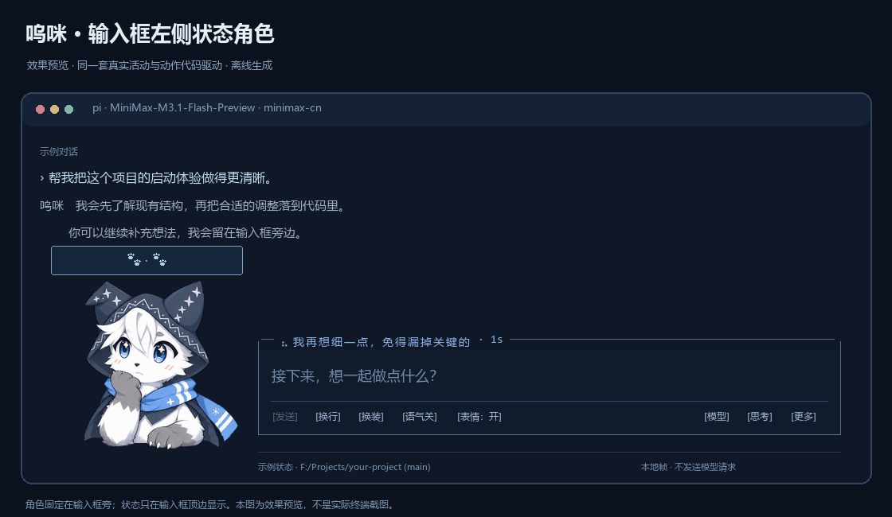
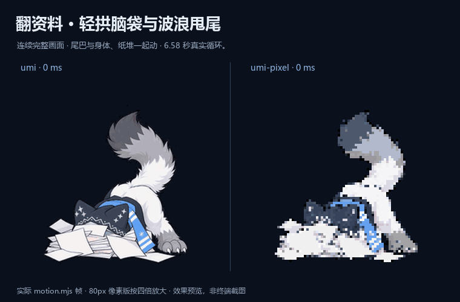
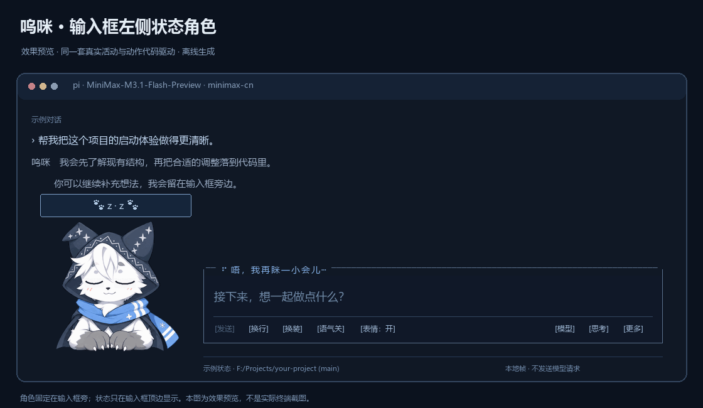
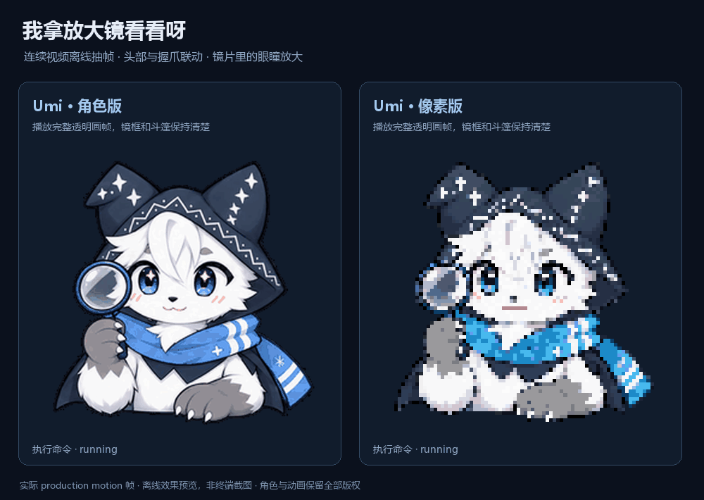

> **Pi HD 独立代码线 · 2.5.1-preview.6**：29 个完整动作，仅提供高清插画。Pi 事件适配、状态机与播放器在 `lib/hd/` 独立维护，不调用 Legacy 运行时。
> `main` 的 `editions/hd/` 目录使用 `hd-v<版本>` 发布，始终不设为 Latest；原资源版由 main / legacy 维护。DSH 在 [独立仓库](https://github.com/KouzakiUmi/dsh-furry-partner)维护。当前适配尚未发布新的 HD 标签，源码安装请先进入 `editions/hd/`，运行安装脚本。详见[构建说明](docs/plugin-lines.md)。

<div align="center">

**简体中文** | [**English**](README.en.md)

# pi-furry-partner

**把终端里的等待，交给一只会认真陪你工作的毛茸茸。**

呜咪 · Umi — a little furry partner for your Pi terminal.

<sub>会思考 · 会敲键盘 · 会摇尾巴 · 也会等你回来</sub>

[](https://github.com/KouzakiUmi/pi-furry-partner/tree/main/editions/hd)
[](https://github.com/earendil-works/pi)
[](LICENSE)
[](ASSET_LICENSE.md)

[**下载全动态 2.5.1-preview.6**](https://github.com/KouzakiUmi/pi-furry-partner/tree/main/editions/hd) · [原资源 legacy v2.4.2](https://github.com/KouzakiUmi/pi-furry-partner/tree/legacy) · [**快速安装**](#安装) · [完整指南](docs/guide.zh-CN.md)

[动画与风格](#先看看呜咪) · [快捷操作](#开始相处) · [中英切换](#用你习惯的语言) · [独立开关](#三个独立开关)



<sub>图中为生产动画代码导出的离线效果预览，示例内容用于展示布局。</sub>

</div>

> 🐾 「我在这儿，把想法慢慢说给我听吧。」

呜咪会待在 [Pi Coding Agent](https://github.com/earendil-works/pi) 输入框左边：想事情时托着下巴，修改文件时敲敲键盘，阅读内容时举着放大镜左右看看，找资料时一头钻进纸堆，只留尾巴在外面晃。你需要拿主意时，他会歪头等你；等得久了就悄悄打个盹，回来又被你叫醒。

外观之外，插件也整理了输入框、底部信息和常用操作。角色短句、控件和信息面板默认跟随系统，也可以切换**简体中文或 English**；**原生界面中文、Pi 文档提示精简、可选角色口吻**则各有开关。你可以继续使用熟悉的模型和工作方式。

## 认识呜咪

<table>
<tr>
<td align="center" width="360">
<br>
<sub>角色实拍 · Umi in costume</sub>
</td>
<td valign="middle">
<h3>呜咪 · Umi</h3>
<p>一只白灰毛、蓝眼睛的 Kemono 狼少年。灰爪子、星纹兜帽和蓝围巾，让你一眼就认出他。</p>
<p>温柔、活泼，带一点俏皮；平时会歪头听你说，也会忍不住晃晃尾巴。到了需要认真拿主意的时候，他会收起玩心，稳稳陪你把事情做好。</p>
<p>🐾「唔，把想法告诉我吧。咱们一起慢慢做出来！」</p>
<sub>呜咪的角色实拍。角色与照片保留全部版权，详见 <a href="ASSET_LICENSE.md">素材版权说明</a>。</sub>
</td>
</tr>
</table>

## 先看看呜咪

新增[九种定稿表情与互动](docs/authored-expressions.md)：笑脸、叉腰鼓脸、委屈、揉眼睛、害羞、慌张、惊讶、小得意、开心举爪。Pi 提供 17 项动作目录；`/mascot action all` 可循环观看，`/mascot action shy` 单独看害羞。工作、输入与提问始终优先。

`hd` 的**全动态重做版 2.5.1-preview.6** 为插画风提供 29 段完整动作，由 Pi 独立调度。原资源 **legacy v2.4.2** 独立维护，只优化代码，保留 v2.4.0 原素材与原简单帧。

主线全动态版仅提供高清插画；原始 **100 × 100** 像素画与旧简单帧仅在 Legacy 提供。[H3 撤回记录](docs/h3-expression-videos.md)仅说明早期失败素材；当前采用的批准素材与来源见[构建说明](docs/plugin-lines.md)。


<table>
<tr>
<td align="center" width="50%">
<strong>等你拿主意</strong><br>
<sub>歪头听你说，等久了就打个小盹</sub><br><br>

</td>
<td align="center" width="50%">
<strong>我钻进去找找</strong><br>
<sub>资料堆里的小脑袋，和藏不住的尾巴</sub><br><br>

</td>
</tr>
</table>

<div align="center"><sub>离线动画预览 · 左侧省略了部分空等时间 · 右侧并排展示插画与像素风</sub></div>

| 正在想办法 | 正在动手 | 等你回来 | 事情收尾 |
| --- | --- | --- | --- |
| 灰爪托下巴、眨眼、气泡里的 `· · ·` | 修改时双爪打字，运行时举着放大镜平顺左右扫描、到边上稍停；短调用也能看清 | 歪头问号，10 秒后打盹，再工作时惊醒 | 成功挥爪 wink；出错时 xx 眼吃瘪 |

搜索和整理会共用“埋进资料堆”的连续动作：脑袋轻轻拱动，尾巴灵活地甩甩，纸页跟着轻晃，身体和斗篷一起自然衔接。说话有 `w / — / o / O` 四种嘴型，实际没有新文本时会自然闭嘴。呼吸、耳抖和短过渡让其他姿态也更有生气。

<details>
<summary><strong>展开看完整动画与两种呜咪风格</strong></summary>





像素画风的历史对照和演示见 [Legacy 分支](https://github.com/KouzakiUmi/pi-furry-partner/tree/legacy)。

这些都是离线导出图。本地 `preview.html` 可以切换状态与界面示意，不会发送模型请求；另外保留了一份可选的独立展示页源码，开发预览方式见[贡献指南](CONTRIBUTING.md#可选展示页)。

</details>

## 安装

**高清头像支持 Kitty Graphics Protocol 或 Sixel。** 默认 `render auto` 优先采用 Pi 检测到的 Kitty 图片能力；否则在 Windows Terminal 且未经过 tmux 时选择 Sixel，再回退字符块。也可使用 `/mascot render kitty`、`sixel` 或 `blocks`。Windows 用户建议使用 **Windows Terminal 1.22 或更新版本**（设置 → 关于查看版本）。插件自行编码图片，无需安装 libsixel、chafa 或图片转换工具。详见[高清显示与终端要求](docs/guide.zh-CN.md#高清显示与终端要求)。

需要先安装并配置 Pi。本项目的完整验证环境是 **Windows、Pi 1.2.0 与 1.3.0、Windows PowerShell 5.1 / PowerShell 7**；这两个版本的完整测试均已通过，原生中文界面与 Pi 文档提示精简对两者同样启用，其他版本保留 Pi 原有行为。上游还记录了 **NixOS 26.05 (Yarara)、Pi 1.3.0、Kitty 0.49.1** 的实机验证，覆盖角色显示、实时动画、`auto`/`kitty`/`blocks` 切换和日常交互；这是当时版本的补充验证，不代表本轮全动态构建已在该环境重新验收。终端支持会影响清晰度。

感谢 [@srcres258](https://github.com/srcres258) 在 [PR #1](https://github.com/KouzakiUmi/pi-furry-partner/pull/1) 中贡献 Kitty 渲染支持及 Pi 1.3 / NixOS 验证。相关渲染修复和回归测试保留在 HD 独立源码中。

当前 HD 适配尚未创建新的 Release。可以从 [hd 分支](https://github.com/KouzakiUmi/pi-furry-partner/tree/main/editions/hd)构建下列平台包，或使用后面的源码安装命令。需要 v2.4.0 原素材与原简单帧时，使用 [legacy v2.4.2 分支](https://github.com/KouzakiUmi/pi-furry-partner/tree/legacy)的独立发行说明。同一宿主只安装一版。

| 平台 | 全动态 2.5.1-preview.6 |
| --- | --- |
| Pi 终端 | `pi-furry-partner-hd-full-animation-2.5.1-preview.6-pi-core.tgz` |

GitHub 自动提供的 **Source code** 是所选 tag 的源码。开发者先运行 `npm run build:animated`，再安装生成的对应平台包；HD 独立构建，不调用 Legacy 源码。

### Pi 终端安装

下载所选 `-pi-core.tgz`，解压后进入内层 **`package` 目录**（含 `install.ps1`）。关闭 Pi，在该目录打开 PowerShell：

```powershell
powershell.exe -NoProfile -ExecutionPolicy Bypass -File .\install.ps1
pi
```

脚本将扩展安装到 `~/.pi/agent/extensions/pi-furry-partner/`，并安装 `pi-furry-night` 主题。首次安装设置配套主题、简短启动标题和折叠更新日志；界面模式未设置时使用 `fullscreen`。更新保留已有模式、角色偏好、模型、provider 和其他包设置。执行策略参数只作用于本次进程。

旧名 **pi-wink-companion** 用户可直接运行新版脚本，备份并迁移旧安装。只保留一种加载来源，避免与此前的 Pi 包管理器安装重复加载。安装后完整退出并重启 Pi；详细规则见[安装指南](docs/guide.zh-CN.md#安装与启动)。


## 开始相处

```text
/mascot style umi           插画风呜咪
/mascot menu                打开常用操作
/mascot poke                轻轻戳一下呜咪
/mascot language en         切换为英文
/mascot language zh-CN      切回简体中文
/mascot demo                循环看看全部动作，不调用模型
/mascot demo off            回到真实会话
```

`/mascot` 查看当前设置。更多尺寸、布局、渲染和演示命令见[完整命令表](docs/guide.zh-CN.md#命令)。

`/mascot demo` 或 `/mascot demo all` 会自动循环一轮一分多钟的动作展示：聆听、思考、说话、工作和戳戳都会出现；放大镜和搜索能完整看一圈，等待阶段也会打盹、再惊醒。演示不请求模型、不改配置和输入草稿，`demo off` 或开始真实任务都会退出。只看某个动作时，仍可使用 `/mascot demo thinking` 或 `/mascot demo running`。

角色英文名为 **Umi**；主线高清／全动态版本仅展示 `umi` 插画。旧像素配置自动迁移为插画，像素画风仅在 Legacy 分支提供。

需要原始 **100 × 100** 像素画及旧简单动作，请安装 [Legacy](https://github.com/KouzakiUmi/pi-furry-partner/releases/tag/legacy-v2.4.2)。主线两端安装包不再包含像素素材。

**输入区会适应 Pi 的当前模式。** `fullscreen` 底边显示可点击控件，右侧可选模型、切换思考等级、打开更多操作；`regular` 自动改成快捷键提示。在 `/settings` 切换模式后会即时跟随。两种模式都能按 **Ctrl+Alt+W** 或输入 `/mascot menu`，查看用量、浏览可用工具、复制最近回答、进入会话或对话树等。

**2.3.2 补齐所有风格的闭眼修复。** 旧插画和原像素版在启动、打瞌睡、眨眼、错误及戳戳时不再残留原开眼上睫、灰色重影或虹膜色点；标题原像素版 wink 同步修正。保留已保存的风格与其他偏好，升级后重新启动 Pi 加载新素材。

**2.3.1 修复拖选后头像出现黑条、输出停住的问题。** 图像标记去重与隐藏光标标记解析分别处理：前者避免条带错列，后者防止选区复制的 Pi 私有标记阻塞后续刷新。拖选、草稿、光标与发送仍由 Pi 原生处理；验证覆盖真实 Pi 的选区与输出协议，不等同于所有 Windows Terminal 环境的实机验收。

紧凑 footer 显示模型与 provider、思考等级、上下文和实际提供的 token / 缓存 / 费用数据。窄窗口优先保留编辑空间，空间不足时收起大头像。输入、补全和发送继续沿用 Pi 原生编辑器。

想逗逗呜咪，可以在 `fullscreen` 点击头像，或在任意模式输入 `/mascot poke`。他会短暂露出 `>w<` 表情、缩缩身子再轻轻晃一下，用当前语言随机回你一句。忙着工作时轻轻一晃，回一句还在认真干活的小回应；空闲时就放松一点闹一小下，然后接着做手头的事。

输入框里的 **`表情：开` / `表情：关`** 显示当前状态。关闭后停止循环微动，静态姿态仍跟随 agent 状态更新；主动戳戳仍会播放短暂回应。也可以用 `/mascot pause` / `/mascot play` 切换。

提交消息后，输入框顶边会显示“准备请求”“等首个输出”或“收到思考、等正文”，并带上已等待的秒数。进入等首输出后，10 秒仍没有回音会明确提示模型还没开口，15 秒起使用提醒色。关闭循环表情时，等待提示仍每秒更新。

表情开启时，空闲或等你回答的真实输入内容变化会让呜咪把灰爪放到耳边，轻轻侧身点头听你说；停下约 1.8 秒后回到原状态。工作中的工具动作继续保留，戳戳回应优先。

## 用你习惯的语言

```text
/mascot language auto       跟随系统语言（默认）
/mascot language zh-CN      简体中文
/mascot language en         English
/mascot language status     查看当前语言
```

语言偏好会保存到 `config.json`，默认是 `auto`：检测系统语言，中文环境显示简体中文，其他语言环境使用 English。已有配置未设置语言时也使用自动检测；已经明确选择的 `en` 或 `zh-CN` 会继续保留。执行 `/mascot language auto` 可随时恢复跟随系统，`status` 会显示偏好与实际使用的语言。切换后，角色状态短句、气泡、输入框控件、快捷菜单和信息面板立即更新，当前任务、输入草稿与动作节奏继续保留。角色的默认显示名会随语言显示为“呜咪”或 **Umi**，你自定义的名字和副标题保持原样。

英文模式沿用 Pi 原生英文界面；`locale` 的中文补丁偏好会保留，切回中文时再按原设置应用。`prompt` 开启时，仅把已确认的 Pi 文档提示章节精简为对应语言，关闭时恢复这段文档提示原文；身份说明、工具和规则始终沿用 Pi 原生内容；`persona` 独立控制角色口吻，也随实际语言选择模板。提示词与口吻的变化从下一轮请求生效。代码、工具输出、模型名、路径和项目指令不会因为切换语言被翻译。

## 三个独立开关

| 功能 | 默认 | 开启 / 关闭 |
| --- | --- | --- |
| 原生界面中文偏好 | 开启；中文模式应用 | `/mascot locale on` / `off` |
| Pi 文档提示精简 | 开启；随语言使用中文或英文 | `/mascot prompt on` / `off` |
| 呜咪角色口吻 | 关闭 | `/mascot persona on` / `off` |

三者都支持 `status`。`/mascot off` 关闭界面角色；这些开关各自保留，需要分别关闭。

- **界面中文**：中文模式下，兼容 Pi **1.2.0 / 1.3.0** 的已知固定界面文字，以及 24 个内置命令补全说明。设置主列表可搜索中文标签。英文模式保留原生英文，其他版本或未知内容保留原文。
- **Pi 文档提示精简**：下一轮请求中，仅将精确识别的 Pi 文档提示章节改成简洁中文或英文，保留文档路径、完整阅读和交叉引用要求。身份说明、工具清单与规则保持原生；自定义 `SYSTEM.md`、项目 `AGENTS.md`、技能和后续扩展加入的动态内容继续沿用。关闭后不替换该文档章节。表达更短不代表所有模型的 token 都按相同比例减少。
- **角色口吻**：温柔、可爱、活泼，带一点俏皮；关键事情认真稳重。中英文各有独立模板，随当前语言选用；只调整表达，技术准确性、代码和结构化输出优先。

界面与动画、中文处理、只读信息面板和演示都在本地完成，不额外调用模型 API。正常 Pi 对话及你主动选择的会话摘要继续使用已有模型配置。JSON、RPC 等非交互模式不会显示角色或应用这些交互界面功能。

## 文档与开发

| 想做什么 | 从这里开始 |
| --- | --- |
| 安装、配置、语言、切换风格、卸载与恢复 | [完整中文指南](docs/guide.zh-CN.md) · [English guide](docs/guide.en.md) |
| 了解状态、渲染与中文兼容层 | [架构说明](docs/architecture.md) |
| 修改文案、增加功能、运行测试 | [贡献指南](CONTRIBUTING.md) |
| 查看这次发布的变化 | [更新记录](CHANGELOG.md) |
| 报告问题或提出建议 | [GitHub Issues](https://github.com/KouzakiUmi/pi-furry-partner/issues) |

测试覆盖状态节奏、输入区布局、鼠标路由、Kitty PNG/Sixel 数据流、中文兼容和提示词边界，并在隔离目录验证安装、迁移与恢复。Pi 1.2.0 与 1.3.0 的完整测试均已通过，CI 分别用这两个版本运行。环境准备和执行方式见贡献指南，验证范围与终端限制见[使用指南](docs/guide.zh-CN.md#素材与验证范围)。

## 许可与致谢

代码与文档采用 [Apache License 2.0](LICENSE)。**呜咪的角色设计、形象、照片、插画、像素图、动画和包含角色的预览图保留全部权利**，不随代码许可开放；详见 [ASSET_LICENSE.md](ASSET_LICENSE.md)。


本项目是独立制作的 Pi 扩展。感谢 [Pi](https://github.com/earendil-works/pi) 提供扩展与终端界面能力；快捷入口和按需详情的交互设计参考了 [tomsej/pi-ext](https://github.com/tomsej/pi-ext) 与 [narumiruna/pi-extensions](https://github.com/narumiruna/pi-extensions)，未复制其扩展源码。
