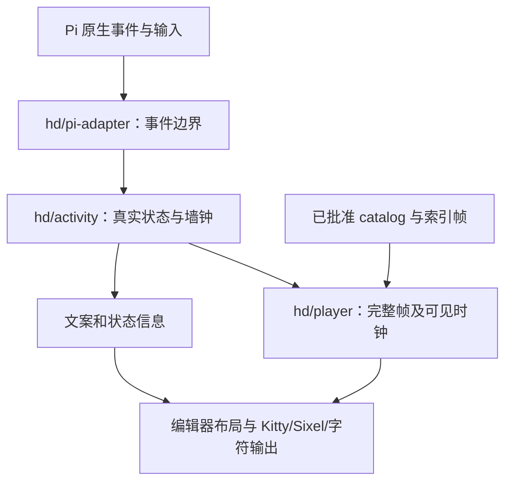

# Pi HD 架构

[HD 指南](guide.zh-CN.md) · [贡献指南](../CONTRIBUTING.md) · [单仓库布局](repository-layout.md) · [全部文档](../../../docs/README.md)

本页相对路径以 main 的 editions/hd/ 为源码根。原资源版位于仓库根目录，DSH 位于独立仓库；HD 不从二者导入可变运行时。

## 模块边界

| 路径 | 职责 |
| --- | --- |
| index.ts | Pi 编辑器、命令、生命周期、单一刷新计时器和图像传输接入 |
| lib/hd/pi-adapter.mjs | 限制 Pi 原生事件；参数流不启用原资源准备姿态；默认 1200ms 驻留和原画静态回退 |
| lib/hd/activity.mjs | 真实 phase/toolCount、并行工具、2000ms 间隙、错误与等待、开场和戳戳 |
| lib/hd/player.mjs | 29 个片段、完整待机循环、键盘链、第一帧可见时钟、缓存与抢占 |
| lib/approved-motion-codec.mjs / lib/approved-motion-node.mjs | 浏览器安全的索引格式和 Node 解压适配 |
| lib/pi-resources.mjs | 本目录素材白名单与版本／路径验证 |
| lib/gestures.mjs / lib/mascot-autocomplete.mjs | 17 项小动作定义与同步补全 |
| lib/kitty.mjs / lib/sixel.mjs / lib/overlay-visibility.mjs | 图像协议、终端坐标、弹层遮挡与释放 |
| assets/animated/ | 29 个完整片段、58 个逻辑索引入口及来源记录 |

## 真实状态与显示

工具结束立即更新真实状态。普通动作最少从首帧实际显示起驻留 1200ms；键盘进入／退出各 400ms，短工作保留至少 800ms 循环。最后工具完成后，只用 pendingNextState 保留安全视觉阶段最多 2000ms，不将工具计数伪装为仍在执行。连续同片段沿原时钟播放，不重播键盘入口；真实回答、用户等待、取消、错误和主动互动按优先级接管。

三条待机各完整播放 4458ms，再选择下一条，长时间隐藏不追播积压。演示巡演按每个片段的实际周期推进（搜索 4833ms、阅读与工作 6583ms、其余 4458ms），不把长片段截在统一时长上。开场与戳戳从第一帧实际显示起计时，加载等待有界，任务开始能打断。戳戳分两段：先显示原画挤眼姿态做整帧刚性回弹 1200ms，再接一段 1200ms 的情境片段；演示巡演只演第一段。缺失资源或暂停使用本目录的原画静态姿态，不调用根目录简单帧形变。

阅读走 watch；编辑和执行走键盘链；搜索与压缩走 search。说话、报错和静态回退使用对应原画／口型策略。17 个可点选手势不是 29 个完整片段的同义列表，实际时长以批准 catalog 为准。

## UI、安装与验证

只有 umi 插画风格，历史像素设置迁移为插画。language、locale、prompt 和 persona 偏好彼此独立；原生中文与提示精简仅启用审阅过的 Pi 1.2.0 / 1.3.0 / 1.4.0，未知版本与用户动态内容保留原样。

Kitty / Sixel / blocks 的选择由实际终端能力决定。fullscreen 使用原生鼠标路由，regular 使用快捷键提示；编辑、选区、IME 和发送不被动画接管。协议与本地模拟检查不等于所有终端目视验收。

安装器只部署所选产品的 index/lib/assets/prompts，保持备份和用户后续设置；包管理与脚本安装择一。CI 在本目录分别运行 Pi 1.2.0 / 1.3.0 / 1.4.0、原始像素与来源校验，以及 PowerShell 5.1 / 7 安装恢复。发布只从 main 的 hd-v 标签构建本目录包，不设 Latest。
